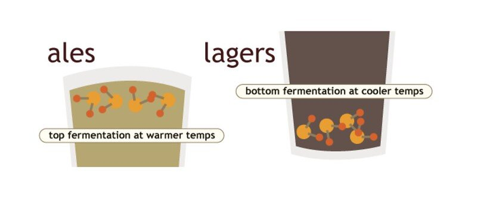
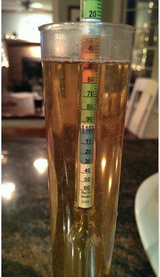
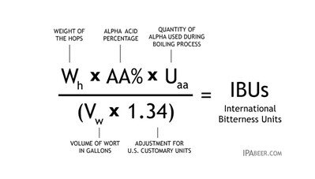
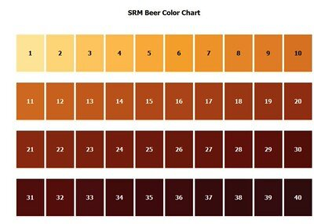
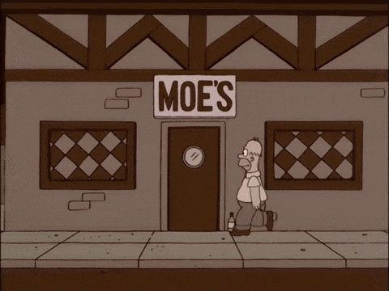
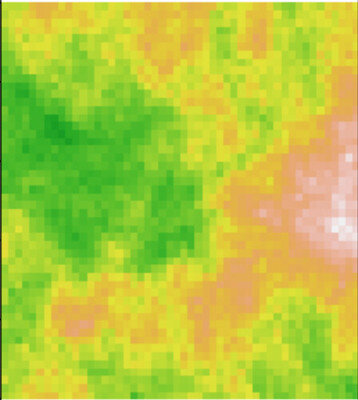
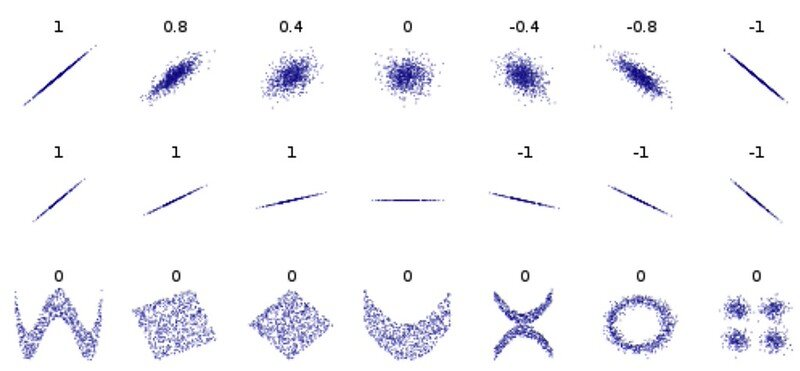

## &nbsp;

```{r}
#| echo: false
#| message: false
#| warning: false
library(tidyverse)
library(fontawesome)
theme_set(theme_minimal(base_size = 16))
```

> ### Correlation is a condition that indicates the extent to which two variables change in a coordinate fashion.  <br/>&nbsp;<br/> This <font color="red">does not</font> imply they are functionally linked or causal in nature.


## Choosing an Approach

```{r}
#| echo: false
#| fig-align: center
source("_extensions/dyerlab/figures_dyerlab.R")
variable_types_grid(highlight = "correlation")
```


# Background {background-color="black" background-image="media/contour.png" background-size="initial" background-position="right"}


## America's Cultural Treasure {background-color="black" background-image="media/NicolasCage.png"} 


## Example Data {.scrollable}

```{r}
#| echo: true
tibble(
  Year = 1999:2009,
  `Nicolas Cage Movies` = c(2, 2, 2, 3, 1, 1, 2, 3, 4, 1, 4),
  `Drowning Deaths in Pools` = c(109, 102, 102, 98, 85, 95, 
                                  96, 98, 123, 94, 102 )  
  ) -> df
head(df)
```


## &nbsp;

```{r}
library(reshape2)
df |>
  melt(id = "Year") |>
  ggplot(aes(Year, value, color = variable)) +
  geom_line() +
  geom_point() +
  theme(legend.position = "top", legend.title = element_blank())
```


## &nbsp;

```{r}
df |>
  ggplot(aes(`Nicolas Cage Movies`, `Drowning Deaths in Pools`)) +
  geom_point() +
  stat_smooth(
    formula = y ~ x,
    method = 'lm',
    se = FALSE,
    color = "red",
    size = 0.5
  ) +
  geom_text(
    aes(
      x = 1.5,
      y = 115,
      label = paste("Correlation = ", format(cor(df[, 2], df[, 3]), digits = 3))
    ),
    size = 6
  )
```

## The Correlation Test

```{r}
cor.test(df$`Nicolas Cage Movies`, df$`Drowning Deaths in Pools`)
```


# New Data Set `r fa("beer", fill='#FDD545'  )` {background-color="#eee" background-image="media/contour.png" background-size="initial" background-position="right"}


## Beer Judge Certification Program {.smaller}

:::: {.columns}

::: {.column width="50%"}
### Recognized Beer Styles

- 100 Distinct Styles (not just IPA's & that yellow American Corn Lager!)  

- Global & Regional Styles

- Quantitative Characteristics
  - IBU, SRM, ABV, OG, FG
  
- Qualitative Characteristics 
  - Overall Impression, Aroma, Appearance, Flavor, & Mouthfeel
:::

::: {.column width="50%"}

:::

::::


&nbsp; 

The [BJCP Style Guidelines](https://bjcp.org/stylecenter.php) exist for beer, mead, and ciders.


## Basic Yeast Types




&nbsp;

&nbsp;

Not including sour beers, which use yeast and bacteria mixtures.


## Dissolved Sugars - OG & FG

:::: {.columns}

::: {.column width="50%"}
The more sugar in the wort, the more food for the yeast to work on, and the more alcohol that may be produced.

The difference between the gravities before and after fermentation can be used to estimate ABV.
:::

::: {.column width="50%"}

&nbsp;


:::

::::


## Bitterness

Bitterness is created by the addition of herbs.





## Color

The color of the beer is quantified using the Standard Reference Method (SRM) scale.





## The Data

Here are the raw characteristic data for the different styles.

```{r}
beer_url <- "https://dyerlabteaching.github.io/CourseData/Miscellaneous/Beer_Styles.csv"
read_csv(beer_url) |>
  mutate(Yeast = factor(Yeast)) -> beer
summary(beer)
```


## Field Trip!    

&nbsp;

<center>

</center>


# Specifics About Statistics {background-color="black" background-image="media/contour.png" background-size="initial" background-position="right"}


## &nbsp; 


:::: {.columns}

::: {.column width="50%"}
### Parameter

Estimating the real value created by the the **entire** population of entities.  

- Mean of the `real` population, $\mu$.

- Variance of the `real` population, $\sigma^2$
:::

::: {.column width="50%"}
:::{.fragment}
### Estimators

The values we get by **sampling** from the much larger population to gain inferences

- Sample mean, $\bar{x}$  

- Sample variance, $s^2$
:::
:::

::::


## Parametric Assumptions

Much of the way we determine the significance of a model is based upon *assumptions* of the underlying data.

- Normality  

- Independence  

- Homoscedasticity


## Normality

In general, data we work with is assumed to follow a Normal distribution with parameters $\mu$ and $\sigma$, often denoted as $N(\mu,\sigma)$, which can be parameterized as: 

&nbsp;

:::: {.columns}

::: {.column width="50%"}
$$
f(x) = \frac{1}{\sigma\sqrt{2\pi}}e^{-\frac{1}{2}\left(\frac{x - \mu}{\sigma}\right)^2}
$$
:::

::: {.column width="50%"}

```{r echo=FALSE}
N <- 1000
data.frame(
  Distribution = rep(c("N(0,1)", "N(10,1)", "N(0,5)"), each = N),
  Data = c(rnorm(N, 0, 1), rnorm(N, 10, 1), rnorm(N, 0, 5))
) |>
  ggplot(aes(Data)) +
  geom_histogram(alpha = 0.75, bins = 50) +
  facet_grid(Distribution ~ .)
```

:::

::::


## Visualizing Normality

Visualizing the 'normality' of the data using built-in functions.

```{r}
#| echo: true
qqnorm(beer$ABV_Min)
qqline(beer$ABV_Min, col = "red")
```


## Testing for Normality {.smaller}

The Shapiro-Wilk test for normality has the null hypothesis: 

$H_O: Data\;are\;normal$


$$
W = \frac{\left(\sum_{i=1}^Na_iR_{x_i}\right)^2}{\sum_{i=1}^N(x_i - \bar{x})^2}
$$ 
where: 

- $N$ is the number of samples, 
- $a_i$ is a standardizing coeeficient, 
- $x_i$ is the $i^{th}$ value of $x$, 
- $\bar{x}$ is the mean of the observed values, and 
- $R_{x_i}$ is the rank of the $x_i^{th}$ observation.


## Shapiro Wilkes Test

The default test for this in `R` is performed by the `shapiro.test()` function.  Here, we will look at the minimum ABV value from the beer dataset.


```{r}
#| echo: true
shapiro.test(beer$ABV_Min)
```

:::{.fragment}
$H_O: Data\;are\;normal$

Is Minimum ABV Normal?  
:::


##  Data Transformations 

### ArcSin Square Root

Fractions and Percentages are known  to behave poorly, particularly around the edges (e.g., close to 0 or 1).  It is not uncommon to use a simple ArcSin Square Root transformation to try to help fractional data.

```{r}
#| echo: true
abv <- beer$ABV_Min / 100.0
asin(sqrt(abv)) -> abv.1
shapiro.test(abv.1)
```

:::{.fragment}
Conclusion? Are these data normal?
:::


## Data Transformations - Box Cox

There is a family of transformations that can be used to see if we can help data sets tend towards normality for parametric analyses.

$$
\tilde{x} = \frac{x^\lambda - 1}{\lambda}
$$


## Data Transformations - Box Cox

```{r}
#| echo: true
test_boxcox <- function(x, lambdas = seq(-1.1, 1.1, by = 0.015)) {
  ret <- data.frame(Lambda = lambdas, W = NA, P = NA)

  for (lambda in lambdas) {
    x.tilde <- (x^lambda - 1) / lambda
    w <- shapiro.test(x.tilde)
    ret$W[ret$Lambda == lambda] <- w$statistic
    ret$P[ret$Lambda == lambda] <- w$p.value
  }

  return(ret)
}
```


## Data Transformations - Box Cox

```{r}
#| echo: true
vals <- test_boxcox(beer$ABV_Min)
vals |> ggplot(aes(Lambda, P)) + geom_line()
```


## Still Not Normal?

```{r}
#| echo: true
vals[which(vals$P == max(vals$P)), ]
```

The best Box-Cox $\lambda$ still gives $P < 0.05$, and so did the arcsine square root.

:::{.fragment}
::: {.callout-important}
Real data often cannot be transformed to normality. When that happens, stop forcing the data to fit the parametric assumptions and use a method that does not need them.
:::
:::


## Equality of Variance

It is assumed that the variance of the data are 

```{r echo=FALSE}
df <- data.frame(x = c(1, 1, 5, 5, 1), y = c(3, 4, 8, 1, 3))
ggplot(df) +
  geom_polygon(aes(x, y), fill = "gray", alpha = 0.75) +
  xlab("") +
  ylab("")
```


## Independence of Data

:::: {.columns}

::: {.column width="50%"}
The samples you collect, and the way that you design your experiments are most important to ensure that your data are individually independent.  You need to think about this very carefully as you design your experiments.
:::

::: {.column width="50%"}

:::

::::


# Correlation Models {background-color="black" background-image="media/contour.png" background-size="initial" background-position="right"}


## Choosing a Correlation

Let the data make each choice:

1. **Test normality.** Both normal $\to$ Pearson.
2. **If not, transform.** Both normal after transforming $\to$ Pearson on the transformed values.
3. **If no transformation works, use ranks** $\to$ Spearman.
4. **If the *P*-value is only an approximation, permute.**

&nbsp;

:::{.fragment}
Then report *every* step you took, not just the final test.
:::


## Parametric Correlation {.smaller}

### The Pearson Product Moment Correlation

&nbsp;

$\rho = \frac{\sum_{i=1}^N(x_i - \bar{x})(y_i - \bar{y})}{\sqrt{\sum_{i=1}^N(x_i - \bar{x})^2}\sqrt{\sum_{i=1}^N(y_i - \bar{y})^2}}$

&nbsp;

whose values are confined to be within the range $-1.0 \le \rho \le +1.0$

&nbsp;

:::{.fragment}
With $H_O: \rho = 0$, whose significance (for normal data) is tested by a $t$ with $N-2$ degrees of freedom:

$t = r \sqrt{\frac{N-2}{1-r^2}}$
:::


## Visual Examples




## Do OG & FG Qualify for Pearson?

```{r}
#| echo: true
shapiro.test(beer$OG_Max)$p.value
shapiro.test(beer$FG_Max)$p.value
shapiro.test(log(beer$FG_Max))$p.value
```

&nbsp;

:::{.fragment}
No. Gravities all sit just above 1.0, so a log barely changes them. We run Pearson anyway, **only** to see how `cor.test()` works.
:::


## The Correlation Test 

As we've used several times so far, the `cor.test()` function performs simple correlation analysis, with a deafult Pearson Product Moment analysis.

```{r}
#| echo: true
cor.test(beer$OG_Max, beer$FG_Max) -> OG.FG.pearson
OG.FG.pearson
```


## The Correlation Test

Again, the object that is returned is a `list` and has these components.

```{r}
#| echo: true
names(OG.FG.pearson)
```


## Non-Parametric Correlation - Spearman's Rho

To alleviate some of the underlying *parametric assumptions*, we can use ranks of the data instead of the raw data directly.  


$\rho_{Spearman} = \frac{ \sum_{i=1}^N(R_{x_i} - \bar{R_{x}})(R_{y_i} - \bar{R_{y}})}{\sqrt{\sum_{i=1}^N(R_{x_i} - \bar{R_{x}})^2}\sqrt{\sum_{i=1}^N(R_{y_i} - \bar{R_{y}})^2}}$


## Non-Parametric Correlation - Spearman's Rho
```{r}
#| echo: true
OG.FG.spearman <- cor.test(beer$OG_Max, beer$FG_Max, method = "spearman")
OG.FG.spearman
```


::: {.fragment}
::: {.callout-important}
Compare $\rho$ and the P-value to the Pearson Product Moment. Since OG & FG are not normal, this is the one to report.
:::
:::


## Ties $\to$ An Approximate P-Value

&nbsp;

> `Cannot compute exact p-value with ties`

&nbsp;

- Many styles share the same maximum gravity, so their ranks are tied.

- With ties, `R` falls back on a $t$ approximation for the P-value.

- Not an error, but it puts us at step 4: permute.


## Permutation for Significance.

Another way to circumvent some of the constraints based upon the form of the data, we can use permutation to test significance directly, without any distributional approximation.

$H_O: \rho = 0$

&nbsp;

Here we permute the Spearman $\rho$ whose P-value `R` could only approximate.


## Setting up Permutations

Permutation requires that we do some simple simulation work, permuting the data **assuming** the Null Hypothesis is *TRUE*.

&nbsp;

```{r}
#| echo: true
x <- beer$OG_Max
y <- beer$FG_Max
df <- data.frame(
  Estimate = factor(c("Original", rep("Permuted", 999))),
  rho = c(OG.FG.spearman$estimate, rep(NA, 999))
)
```

## Setting Up the Permutation

&nbsp;

```{r}
#| echo: true
head(df)
```


## Permuting "Under the Null"

Now, we can go through the 999 `NA` values we put into that data frame and:  
1. Permute one of the variables  
2. Run the analysis    
3. Store the statistic.  

::: {.fragment}
::: {.callout-tip}
$H_O:$ There is no correlation.

If $H_O$ is correct then the original value should look like *just another* permuted value.
:::
::: 


## Permuting "Under the Null"

Shuffle the `y` variable and recalculate the test statistic 999 times.  

```{r}
#| echo: true
set.seed(543)
for (i in 2:1000) {
  yhat <- sample(
    y, # this shuffles the data in y
    size = length(y),
    replace = FALSE
  )
  df$rho[i] <- cor(x, yhat, method = "spearman")
}
```


## Visualizing the NULL

Probability of a value as extreme or greater than the original estimate $\to$ P-value.

```{r fig.height=5}
#| echo: true
ggplot(df) +
  geom_histogram(aes(rho, fill = Estimate))
```


## The Permutation P-Value

The fraction of the 1,000 values (original included) at least as extreme as the original.

```{r}
#| echo: true
sum(abs(df$rho) >= abs(df$rho[1])) / 1000
```

:::{.fragment}
The smallest P that 999 permutations can measure. It agrees with `cor.test()`: OG & FG are positively correlated.
:::


## Conclusions

Measures of correlation determine the co-movement of two variables **without** making any statement regarding causation.

1. Test normality: normal data $\to$ Pearson.  
2. Not normal? Try a transformation.
3. Still not normal? Ranks $\to$ Spearman.
4. Approximate P-value? Permute.


## Questions

::: {layout-ncol="2"}
If you have any questions, please feel free to either post them as an "Issue" on your copy of this GitHub Repository, post to the [Canvas](https://canvas.vcu.edu) discussion board for the class, or drop me an [email](mailto://rjdyer@vcu.edu).

{.middle fig-alt="Peter Sellers looking bored" fig-align="center" width="500"}
:::
